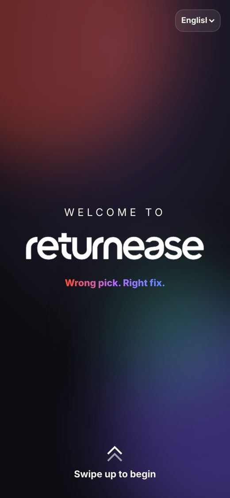
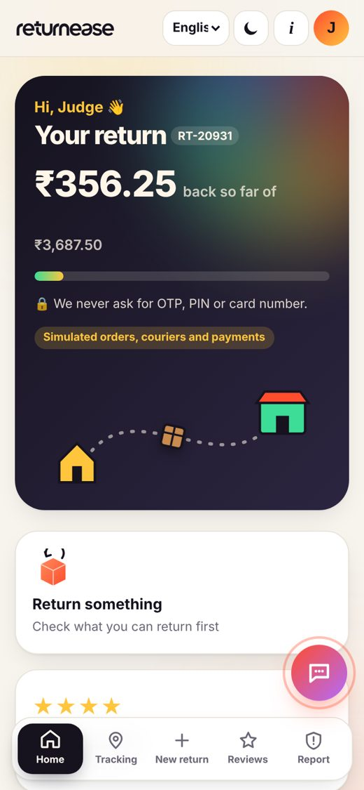
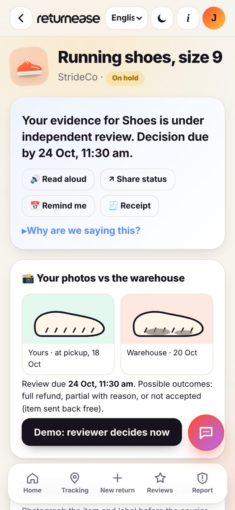
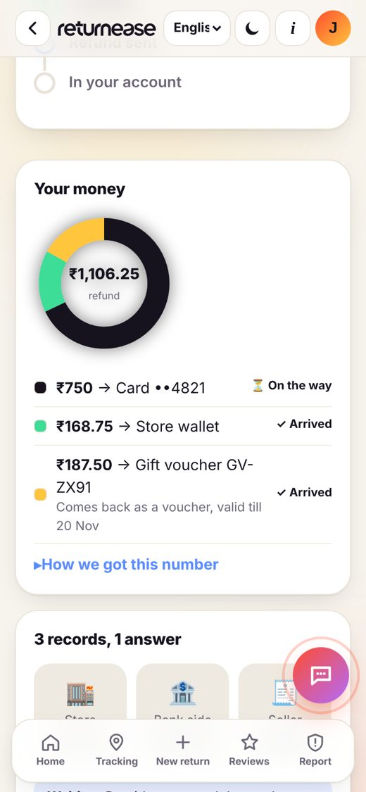
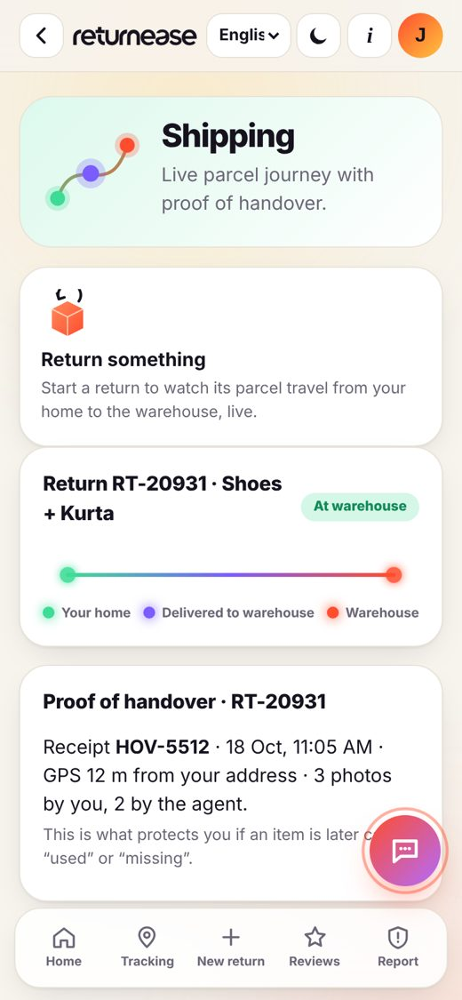
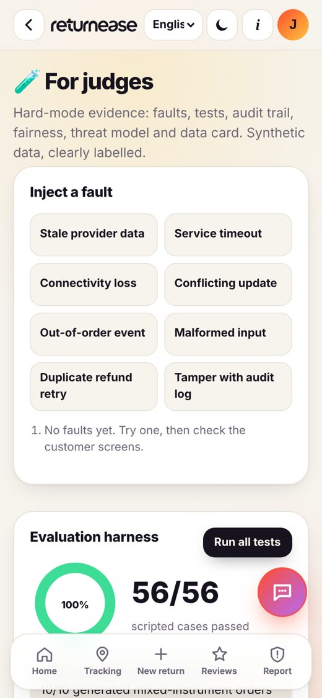

<div align="center">


### Wrong pick. Right fix.

**Item-level returns and refunds you can actually follow.**
IMPACTX 2026 · VIT-AP · Challenge 15 "The Return That Shouldn't Be a Hassle" (Hard Mode)

**[▶ Open the live app](https://impactx-2026-seven.vercel.app/)** · Judge login: `judge@returnease.demo` / `Impactx@2026`

  -FFC53D)  

</div>

<p align="center">
  
  
  
  
  
  
</p>

---

## The problem
Lakshmi orders 4 items from 3 sellers and pays by **card, wallet and a voucher**. She returns 2. Pickup fails twice ("customer unreachable", but she was home). The warehouse calls her shoes "used". Her bank says the refund was **reversed** while the seller still says **pending**. Part of it comes back as a voucher. Then she is flagged "risky" for honest size returns.

**Her question: where is my money, and who do I believe?**

## What returnease does
| Hard moment | returnease |
|---|---|
| Pickup fails | Courier GPS + call logs decide blame. 1.8 km away = courier's fault, never counted against the customer |
| Flagged "used" | Handover photos vs warehouse photos, reviewed by a separate team within 72 h: full, partial (with %) or rejected (sent back free) |
| Paid 3 ways | Every rupee split to the paisa across card / wallet / voucher, with a date per method |
| Bank ≠ seller | Three records, one answer: **Waiting**, **Stuck** or **Unknown**, plus the next step for customer, platform, seller and bank |
| Gateway retry | Idempotent refunds: one key per return·item·method, never paid twice |
| Many returns | Fraud ladder with a fairness check and one-tap human appeal |
| Tampering | SHA-256 hash-chained audit log: edit any entry and the chain breaks |

## Features
**Customer app:** welcome + sign-in · tracking · returns (refund / exchange / replacement side by side) · exchange · checkout with refund preference · shipping (home → warehouse) · reviews · fraud reporting · chat assistant

**Added in round 2**
- **Installable + offline** (PWA): add to home screen; works with no network
- **Voice**: speak your question in your language; **Read aloud** on every status
- **Handover proof photo**: camera capture, stamped with time + SHA-256 in the audit log
- **Remind me**: refund or inspection date straight into your calendar (.ics)
- **Receipt**: print or save a clean refund receipt as PDF
- **Share status**: phone share sheet or WhatsApp
- **Bigger text** for low-vision users
- **Motion everywhere**: page entrances, card lift, breathing status pills, star pops (respects "reduce motion")

**Accessibility & inclusion:** 8 languages (English, Hindi, Telugu, Tamil, Kannada, Malayalam, Marathi, Bengali) · dark mode · voice in and out · bigger text · screen-reader labels · works on cheap phones and slow networks · never asks for OTP/PIN

## Try it in 60 seconds
1. Open the [live app](https://impactx-2026-seven.vercel.app/) → swipe up → **Sign in** (judge login is pre-filled)
2. **Shoes** → "Demo: reviewer decides now" → full refund
3. **Kurta** → Your money → **3 records, 1 answer** → Waiting
4. **New return** → Bedsheet → Size → compare 3 options
5. Account menu → **For judges** → *Duplicate refund* · *Tamper* → Restore · **Run all tests** → 56/56

## Results
Run `node tests/run.js`, or Judge console → **Run all tests**.

| Metric | Result |
|---|---|
| Scripted cases | **56/56 pass** |
| M1 Refund allocation correctness | 10/10 generated mixed-payment orders + 8/8 hand-checked |
| M2 Status mismatches classified (waiting / stuck / unknown / done) | 10/10 |
| M3 Fraud false positives on genuine heavy returners | **1/8 = 13%** (naive volume rule: 7/8 = 88%); abusers still caught 4/4 |

> All orders, couriers, banks and sellers are **simulated**. Real-world accuracy needs a pilot.

## Architecture
```
Customer app (screens only)  →  Rules engine (pure functions)  →  Supabase (Mumbai, RLS)
 app.js · i18n.js · art.js        engine.js                        accounts · saved state ·
                                   state machines · waterfall ·      reviews · chat · reports
                                   reconciler · ledger · judges ·
                                   fraud ladder · audit chain        offline fallback on device
```
| File | Role |
|---|---|
| `js/engine.js` | Every rule as a pure, testable function |
| `js/scenario.js` | Synthetic scenario from the brief + 18 planted conflicts + seeded returners + threat model |
| `js/tests.js` | Evaluation harness: 56 cases + 3 metrics |
| `js/app.js` | All screens, chat assistant, judge console, voice, photos, reminders |
| `js/api.js` | Tiny Supabase REST client with automatic on-device fallback |
| `js/i18n.js` | 8 languages |
| `sw.js`, `manifest.webmanifest` | Installable offline app |

**Design rules:** item and money are separate state machines (illegal or out-of-order moves rejected) · money stored as integer paise, split by largest remainder · voucher refunds stay vouchers with ≥ 30 days of life · nothing says "reached your account" before the provider confirms · one idempotency key per refund part · no OTP/PIN ever requested.

More: [`DATA_CARD.md`](DATA_CARD.md) · [`THREAT_MODEL.md`](THREAT_MODEL.md)

## Run locally
No build step.
```bash
git clone https://github.com/joeljosephb2008-cell/impactx-2026.git
cd impactx-2026
python3 -m http.server 8000      # then open http://localhost:8000
node tests/run.js                # 56/56
```
Deploys automatically to Vercel on every push to `main`.

## Team Sleepy Coders
| Member | Owns |
|---|---|
| **B Joel** (lead) | State machines, 3-source reconciliation |
| **Sameer SK** | Refund waterfall, vouchers, idempotency |
| **Tejasvi G** | Pickup & inspection disputes, fraud ladder, options |
| **Nikitha V** | Tests, audit chain, data card, app & UI |

## AI use
Built with help from Claude (AI assistant), as the IMPACTX rules allow. The team chose the scope, tested every flow and can explain every function.
